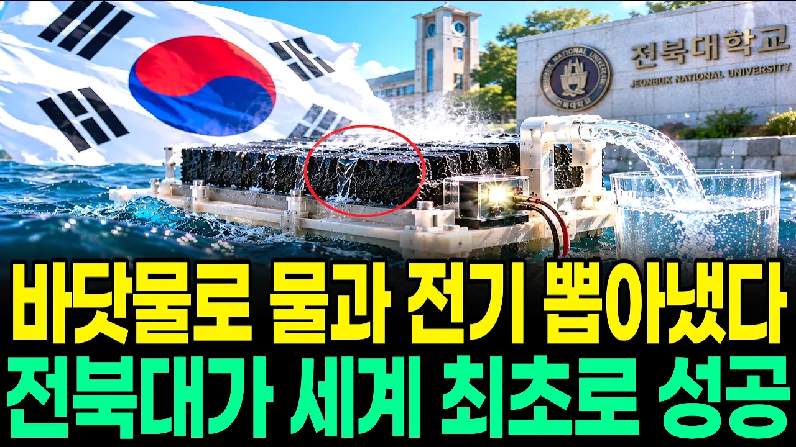

# "버린 나무로 바닷물을 식수로 바꿨다" 전북대 세계 최초 해수담수화 기술, 식수와 전기를 동시에 만든 진짜 이유

## 기본 정보
- **URL**: https://www.youtube.com/watch?v=R5wb3Nt1jOM
- **채널명**: 지식발굴단
- **구독자수**: 3만
- **조회수**: 142,815
- **업로드일**: 2026-10-25
- **영상 길이**: 28:56
- **댓글 수**: 28
- **좋아요 수**: 1,304

## 썸네일

---

## 댓글 (추천순 TOP 10)

| 순위 | 좋아요 | 댓글 |
|------|--------|------|
| 1 | 4 | 전북에서 그 연구 결과가  나왔다고  이야 놀랍습니다 감사합니다 |
| 2 | 15 | 대한민국 에는 천재들이 넘치네! 화이팅!❤❤❤ |
| 3 | 1 | 전북대 연구비 354억이라구요... 와....전북이니 가능한 연구였네..ㅠㅠ |
| 4 | 11 | 대한민국 만세!!!! 전북대학교 화이팅!!!!! |
| 5 | 3 | 정말 놀랍고 자랑스러운 대한민국의 기술력이네요! 🇰🇷 버려지는 나무를 활용해 바닷물을 식수로 바꾸고 전기까지 생산한다는 발상이 정말 혁신적입니다. 환경 보호와 물 부족 문제를 동시에 해결하려는 우리 연구진의 도전에 박수를 보냅니다! 👏❤ 이런 훌륭한 기술을 소개해 주셔서 감사합니다! |
| 6 | 10 | ❤🎉❤🎉 와우~~~최고에요 |
| 7 | 11 | 해수담수화는 오래전부터 실용화 됐었다! 더 간편한 새로운 방법을 개발한거냐? |
| 8 | 9 | 저번에는 서울대에서 바닷물로 석-우만든다더라. 지화자. 전북대도 지화자. |
| 9 | 0 | 괜히 슬퍼지는 댓글이네요 |
| 10 | 1 | 전북대    대박입니다 전라북도를 하느님께서 축복을 주시는군요 |
