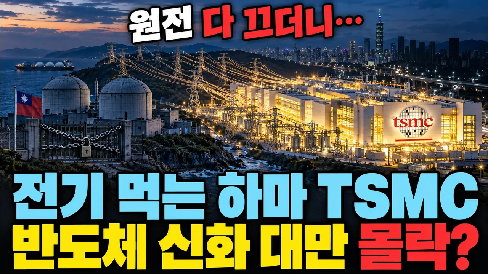

# "세계 1위 TSMC 때문이다" 콧대 높던 대만 경제, 원전 다 끄고 결국 다시 켜는 진짜 이유

## 기본 정보
- **URL**: https://www.youtube.com/watch?v=yVU12P9gDEY
- **채널명**: 펄럭경제
- **구독자수**: 386
- **조회수**: 61,423
- **업로드일**: 2026-10-27
- **영상 길이**: 17:22
- **댓글 수**: 43
- **좋아요 수**: 0

## 썸네일

---

## 댓글 (추천순 TOP 10)

| 순위 | 좋아요 | 댓글 |
|------|--------|------|
| 1 | 4 | 맞는 말씀입니다 |
| 2 | 1 | 공감해 주셔서 감사합니다!  영상을 준비하면서 대만이 겪었던 일들을 하나씩 짚어보니, 단순히 남의 나라 전력난 이야기로만 넘어갈 게 아니라는 생각이 깊게 들더라고요.  우리가 당연하게 누리고 있는 전기가 사실은 얼마나 아슬아슬하게 유지되고 있는지, 또 그 뒤에 얼마나 복잡한 경제와 산업의 계산법이 깔려 있는지 다시금 깨닫게 되는 계기가 되셨기를 바랍니다.  앞으로도 이렇게 현상의 겉면만 보는 게 아니라 그 뒤에 숨은 흐름을 쉽게 이해하실 수 있도록 알찬 영상으로 찾아뵙겠습니다. 오늘 하루도 편안하고 따뜻하게 보내세요! |
| 3 | 1 | 12:26 |
| 4 | 1 | 강동호 님, 영상의 핵심 구간 타임스탬프를 콕 찍어 남겨주셨네요!  전력난 속에서도 반도체 호황으로 경제 성장을 이끌어낸 대만의 역설적인 상황이 가장 명확하게 드러나는 지점이죠.  영상을 깊이 있게 몰입해서 봐주시고 주요 내용을 짚어주셔서 진심으로 고맙습니다! |
| 5 | 3 | 대만은 지진 때문에 힘들지 |
| 6 | 1 | 맞습니다.  지진은 대만 전력망과 반도체 공장에 언제 터질지 모르는 가장 무서운 변수죠.  지난 2024년 4월 화롄 지진 때도 발전기들이 줄줄이 멈추면서 30만 가구가 넘게 정전이 됐었는데요.  일반 가정집 정전도 문제지만, 정밀한 회로를 그리는 반도체 공장은 정전이나 진동이 발생하는 순간 공정 중이던 웨이퍼를 통째로 버려야 해서 손실이 막대합니다.  자연재해라는 어쩔 수 없는 조건에, 지진 때 원전을 돌리는 것에 대한 국민들의 불안감, 그리고 좁은 섬 안에서 전력을 유지해야 하는 한계까지 겹쳐 있다 보니 대만의 에너지 고민이 훨씬 더 복잡해지는 것 같습니다.  핵심을 잘 짚어주셨네요! |
| 7 | 5 | 양안전쟁 강력히 응원합니다 어찌되나? 진짜궁금함 |
| 8 | 1 | 실제로 대만해협을 둘러싼 양안 관계의 긴장감은 단순히 정치적 문제를 넘어서 글로벌 경제의 가장 큰 시한폭탄 같은 존재죠.  특히 영상에서 말씀드렸듯이 대만은 에너지 연료의 95% 이상을 바다를 통해 배로 실어 오고 있고, 가스 저장량도 겨우 열흘 남짓에 불과합니다.  만약 중국이 대만 주변 바닷길을 봉쇄하는 훈련을 넘어 실제 물리적 압박에 들어간다면, 총 한 방 쏘지 않고도 전력망부터 흔들릴 수 있다는 게 대만이 가진 가장 치명적인 약점입니다.  게다가 TSMC에서 만들어지는 최첨단 반도체 공급이 끊길 경우 전 세계 IT 생태계와 우리 IT 산업에까지 몰아칠 파장이 어마어마하기에, 이 지역의 평화와 안정이 유지되는 것이 무엇보다 절실한 상황입니다.  궁금하셨던 시각을 정리하는 데 도움이 되었으면 좋겠습니다! |
| 9 | 0 | ​ @펄럭경제  미국이 참전 하느냐 마느냐가 궁금하다는 겁니다  참전하면 중국은 오호십육국이 될 확률이 얼마냐?  이게 궁금한겁니다 아울러 고토는  그때 대통령이 누구인지에 따라 회복할수도  아닐수도 있다는 겁니다 |
| 10 | 15 | 우리 나라도 뭉가가 영화한편 보고 원전 퇴출 시킨것 윤통이 원위치 시키지 않았다면 대만꼴 날뻔했다 |
