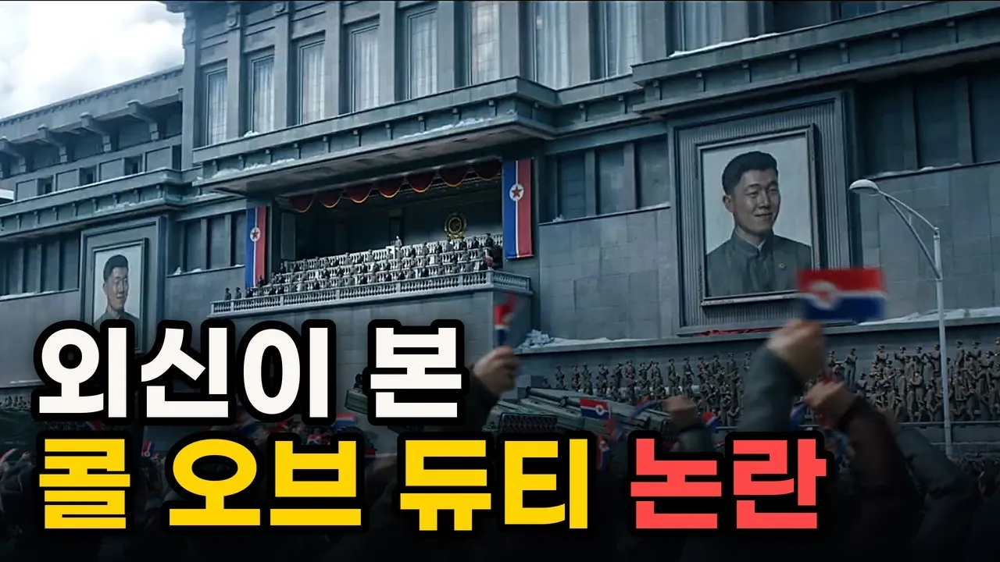

# 콜 오브 듀티 논란, BBC·CNN·AFP·뉴욕 타임스는 어떻게 봤나  - 글로벌 외신 반응

## 기본 정보
- **URL**: https://www.youtube.com/watch?v=sF-2_3PGonI
- **채널명**: M경제브리핑
- **구독자수**: 1,940
- **조회수**: 8,801
- **업로드일**: 2026-10-26
- **영상 길이**: 8:09
- **댓글 수**: 57
- **좋아요 수**: 40

## 썸네일

---

## 댓글 (추천순 TOP 10)

| 순위 | 좋아요 | 댓글 |
|------|--------|------|
| 1 | 0 | <한국 언론, 왜 중국 언론 받아쓰나?> 최신 영상도 같이 시청해 주세요. https://youtu.be/rXZv7-6mrms?si=7sckujKVeyiCcSi9  시청해주셔서 감사합니다! |
| 2 | 24 | 주적을 북한이라도 말 못하는 정권과 당의 안보 관념은 심각한 수준이다 |
| 3 | 0 | 콜옵1 배경이 2차세계대전.. 한글판도 없었던것 같은데.... 그냥 게임은 게임으로 봐야할듯 그리고 무슨 초딩 때쓰듯 빽빽 거리지 말고 중국인 처럼 억지,날조 부리지 좀 말고 국제정세와 언론이 뭔지 부터 배우길 |
| 4 | 2 | 선거 이기려고 북한의 침공 유도한 놈들 보단 나은데?  한 쪽이 "안보 관념 심각"이면 대놓고 전쟁 유도 시도한 놈들은 뭐라고 불러야 함?   "국가반역" 말고 또 뭐 있나? |
| 5 | 4 |  @kweassa_HidingFromCC  침공유도 ㅋㅋ 겨우 무인기 깔작거린다고 북한이 선제공격을 할거라 생각하니? 북한은 유지가 목적이지 전쟁을 바라지 않음. 북한뿐아니라 중국도 북한의 선제공격으로 전쟁이 시작되는건 원하지 않아. 보편상식을 가지면 누구나 알수있는 상황을 북한비위맞추면서 아무말 못하는게 멍청하고 한심한거다. 이재명이 한심할진 몰라도 멍청하진 않는데도 북한에 저자세로 나가는건 대북송금으로 약점잡혔다는 의심이 들수밖에 없는거고. |
| 6 | 0 | ​​ @김지현-b1g 북한체제 유지라고 하면서 슬금슬금 지뢰까고 김포앞바다에 탱크 세워서 조준하고 자빠졋노 ㅋㅋㅋㅋ |
| 7 | 1 | ​ @kweassa_HidingFromCC 그런게 언제 있어요??? 웅엥웅엥 |
| 8 | 20 | 논란거리도 아닌 걸 애써 논란으로 만들려하지 마라. 정권이랑 간첩 빼곤 아무도 논란이라고 생각 안 해. |
| 9 | 0 | 극우들 오늘 좌표는 여기냐? 북이 핵을 쏴서 수도권 인구 천만 명이 사망하는 내용이어도 게임이니까 괜찮다고 할거냐? 일제 강점기 새대를 배경으로 하는 게임에서 조선 백성들이 고문을 당하는 장면이 나오면 적어도 한국인은 기분이 나쁜게 정상이잖아. 창작의 자유와 별개로 한국의 불행한 상황을 소재로 한 내용이면 당사자인 한국인은 불쾌한게 정상인데, 이걸 또 진영논리로 편을 갈라서 오히려 재밌는 게임이라고? 이볃싣아 다른 나라 사람에게는 논란이 아니지만 한국인한테는 당연히 논란이지 니 머가리는 라면사리만 들었냐? 진짜 정치병에 걸리면 정상적인 사고 자체가 안되는구나. |
| 10 | 0 | ​ @johnyu2532 이게 극우라고 하면 대체 이 사람는 평소에 무슨생각을 하고 살까😂 |
