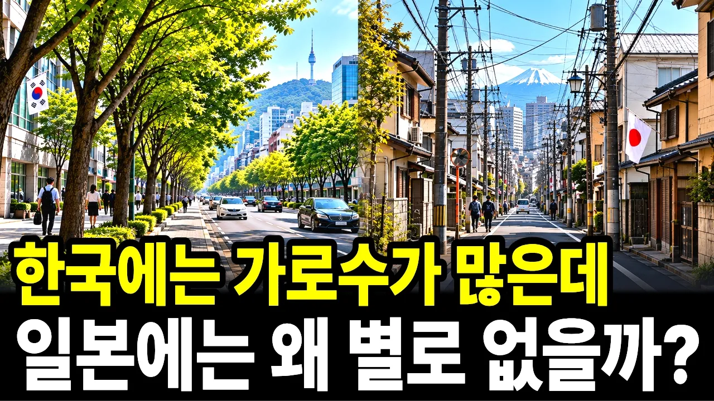

# 한국엔 가로수가 많은데, 일본엔 왜 가로수가 안 보일까?

## 기본 정보
- **URL**: https://www.youtube.com/watch?v=um6rwGej0xQ
- **채널명**: 잡학도깨비
- **구독자수**: 2,440
- **조회수**: 330,774
- **업로드일**: 2026-10-30
- **영상 길이**: 19:01
- **댓글 수**: 307
- **좋아요 수**: 1,725

## 썸네일

---

## 댓글 (추천순 TOP 10)

| 순위 | 좋아요 | 댓글 |
|------|--------|------|
| 1 | 76 | 그래서 일본 여름에 길 걸으면 아스팔트 열기가 장난이 아님… 길에 가로수 한그루 없어서 그늘막이 되주는 곳이 현저히 적어 열사병으로 사망하기 쉬움 |
| 2 | 0 | 공감합니다. 2025년 여름 도쿄 도심은 35도 넘는 날이 열흘 연속 이어졌고, 5~9월 열사병으로 구급 이송된 사람이 10만 명을 넘어 역대 최다였다고 해요. 그늘이 부족하다 보니 일본에선 남성들도 양산을 많이 쓰고 다니죠. 여름에 일본 가시는 분들은 꼭 양산이나 모자 챙기세요 |
| 3 | 95 | 흥미롭당---- 가을철 낙엽치워주시는 청소 노동자분들께 깊은 감사🙏🏻🍂 |
| 4 | 3 | 가을엔 낙엽이 흩날리고 밟기도하고 이러면서 계절을 느끼며 사는게 너무좋음.. |
| 5 | 1 | 저도 같은 마음입니다. 가로수 길이 아름다운 건 그분들 덕분이죠 🍂🙏 |
| 6 | 0 | 요즘부터 시작이죠. 낙엽이 파도처럼 어마어마 하던데 고생 많으세요. 노고에 감사합니다. |
| 7 | 61 | 그러네  이제서야 보니 알았다  관심없이 가보니 그러네~ |
| 8 | 0 | 그렇죠! 저도 처음엔 그냥 깨끗하다고만 느꼈는데, 알고 보니 가로수 대신 전봇대가 서 있더라고요 😄 다음에 일본 가시면 골목길과 큰길을 한번 비교해 보세요. 차이가 확 보입니다! |
| 9 | 48 | 도시에도 나무가 많은게 미감에도 좋고 시원해서 좋음 |
| 10 | 0 | 맞아요! 보기에도 좋고, 여름엔 나무 그늘이 정말 큰 차이를 만들죠. 도쿄대 조사에서도 도쿄 도심의 나무 그늘이 9년 만에 5분의 1 넘게 줄었다고 하는데, 그래서인지 일본에서도 요즘 가로수의 가치를 다시 보는 분위기라고 합니 |
