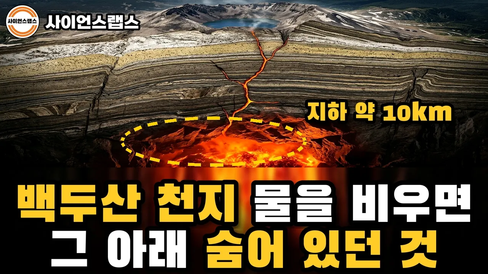

# 백두산 천지 물을 다 빼면 드러나는 것들 | 384m 바닥 아래, 아직 식지 않은 불

## 기본 정보
- **URL**: https://www.youtube.com/watch?v=IhbxANAPRlg
- **채널명**: 사이언스랩스
- **구독자수**: 7만
- **조회수**: 64,349
- **업로드일**: 2026-10-17
- **영상 길이**: 13:22
- **댓글 수**: 9
- **좋아요 수**: 174

## 썸네일

---

## 댓글 (추천순 TOP 10)

| 순위 | 좋아요 | 댓글 |
|------|--------|------|
| 1 | 1 | 천지의 물을 한 층씩 빼 보니, 가장 놀라웠던 건 어느 거였나요?  1. 원래 물고기가 한 마리도 없던 호수였다는 것 2. 발해는 폭발보다 20년 먼저 망했다는 것 3. 천지가 1,000여 년 전 스스로 물을 빼 버린 적이 있다는 것 4. 바닥 아래에 아직 식지 않은 마그마 방이 있다는 것  댓글로 번호와 이유를 남겨 주세요. 다음에 물을 빼 보고 싶은 호수나 바다도 환영합니다. |
| 2 | 8 | 안타까운  백두산 중국에    반을    팔아먹어서 장백산이     뭐냐 백두산이지ㆍ 다시     찾아올수    잇으면ᆢ |
| 3 | 0 | 한국에는 백두산 화산재가 못온다고 들었는데 아닌가보네요. 바람방향때문이라고 하던데 |
| 4 | 0 | 평균수심 200m |
| 5 | 0 | 흰산이 힘을... |
| 6 | 0 | 요즘 민욱? 목소리가 인기네 |
| 7 | 0 | 이 집 영상 소재가 괜찮다보니 이것 저것보는데 뭔가 답답하고 2프로 부족하길래 뭔가 싶어 곰곰히 생각해봤는데..... 내용이 뒤죽박죽이라 집중안되고 지루해짐 그리고 저 목소리 환장할노릇 금마군. |
| 8 | 1 | 나 물빼는 이야기 좋아하네 |
| 9 | 0 | 창바이산 한자로 장백산 하버드 케임브리지 옥스퍼드 등 미국 영국 50여개 대학이 인정한 국제 학술용어. |
