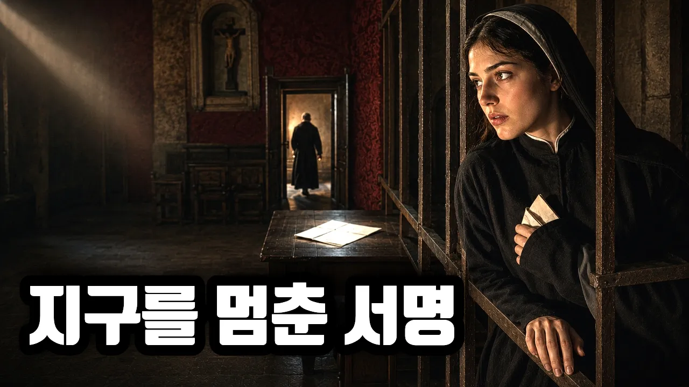

# 갈릴레오를 무릎 꿇린 건 지동설이 아니었다 | 1633년 로마 종교재판과 359년의 침묵

## 기본 정보
- **URL**: https://www.youtube.com/watch?v=DNwqHWoF6NE
- **채널명**: 타임트래블로그
- **구독자수**: 6,240
- **조회수**: 2,799
- **업로드일**: 2026-09-15
- **영상 길이**: 21:06
- **댓글 수**: 5
- **좋아요 수**: 15

## 썸네일

---

## 댓글 (추천순 TOP 10)

| 순위 | 좋아요 | 댓글 |
|------|--------|------|
| 1 | 1 | 심문관은 학설을 반박하는 대신 펜을 내밀었고, 갈릴레오는 종이 맨 아래 빈 줄에 자기 이름을 적었습니다. 여러분이 보시기에 이건 굴복이었을까요, 아니면 거래였을까요? |
| 2 | 3 | 지동설이고 나발이고 그걸 저 난리를 벌이기 위한 구실일 뿐이고 책에서 어리석은 자로 나와서 빡친 교황의 복수극이라는 생각이 지워지질 않는......  물론 지동설과 천동설 문제도 심각하긴한데 저건...... |
| 3 | 1 | 아이러니 한 것은... 동양에는 이 시절에도 천지음양 같은 강아지 멍멍 소리만 했음. |
| 4 | 0 | 처벌 내용 ===> 매일 반성문 제출하세요. (갈릴레오랑 교황이 친구였음) |
