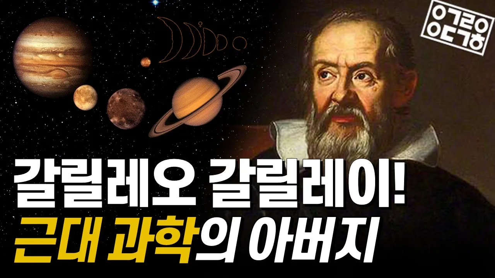

# '갈릴레오'의 고난과 위대한 업적을 아십니까?! 근대 과학의 아버지, 갈릴레오 갈릴레이 이야기

## 기본 정보
- **URL**: https://www.youtube.com/watch?v=IFl4YrEz2IY
- **채널명**: 안될과학 Unrealscience
- **구독자수**: 141만
- **조회수**: 121,389
- **업로드일**: 2021-12-05
- **영상 길이**: 9:03
- **댓글 수**: 130
- **좋아요 수**: 1,898

## 썸네일

---

## 댓글 (추천순 TOP 10)

| 순위 | 좋아요 | 댓글 |
|------|--------|------|
| 1 | 83 | 과학자와 철학자가 처음으로 분리된 순간 |
| 2 | 0 | 신학이 정규전에서 과학의 요소를 받아들여 진화하는 징조가 갈릴레오 |
| 3 | 5 | 자연철학인 과학과 종교철학(=자칭 신학)이 분리된 순간, 그리고 종교철학은 퇴보하기 시작한 순간 |
| 4 | 1 | 뭔..ㅋㅋㅋ 종교철학은 신학을 말하는 건가 싶은데 그 이후로도 잘 나갔습니다. 계몽주의가 진전되고 세속화가 이루어진 건 18세기 프랑스고요 독일 쪽에선 신비주의 사조 등 독일 관념론이 잘 나갔습니다. 우리가 아는 피히테, 셸링, 칸트, 헤겔도 다 그 전통에 서 있는 사람들이고 굉장히 신학적인 성격이 짙은 철학 사상을 갖고 있는 사람들이에요. 그걸 때려 부순 게 니체죠. |
| 5 | 0 | 첫댓 다신분 영상은 보시고 댓글 다신건가 싶네요 ㅎㅎ |
| 6 | 13 | 사실 교황이 빡돈건 자기랑 약속한 내용이 달라서가 아니라 책에 교황의 견해와 교회측 지식인들을 몽땅 싸잡아서 욕하는 내용이 좀 있었기 때문에... |
| 7 | 3 | 무식한 사람이 신념을 가지면 무섭지만 유식한 사람이 신념을 가지니 매섭네 |
| 8 | 9 | 갈릴레오 같은 사람이야말로 진정 성인이라고 생각합니다 요즘 젊은 세대가 종료를 믿지 않는 이유이기도 하구요 |
| 9 | 36 | 안될 과학도 과학을 더 쉽고 재밌게 알리기 위해서, 모두가 안될거라고 해도 계속 노력한 덕분에 여기까지 오신거 같습니다. 갈릴레오와 같은 과학자 정신 ㄷㄷ 앞으로도 응원할게요! |
| 10 | 1 | 크~👌 |
