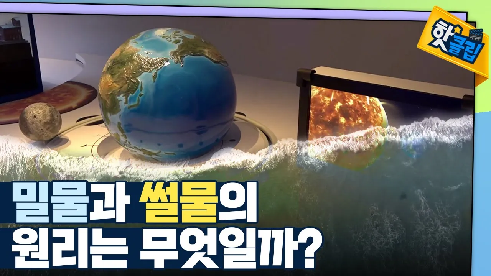

# [핫클립] 밀물과 썰물 속 수학 원리 / YTN 사이언스

## 기본 정보
- **URL**: https://www.youtube.com/watch?v=M-d68eENoao
- **채널명**: YTN 사이언스
- **구독자수**: 86만
- **조회수**: 120,022
- **업로드일**: 2022-04-15
- **영상 길이**: 2:06
- **댓글 수**: 54
- **좋아요 수**: 598

## 썸네일

---

## 댓글 (추천순 TOP 10)

| 순위 | 좋아요 | 댓글 |
|------|--------|------|
| 1 | 5 | 저는  국내최초 3차원  면진장치  발명가  입니다  온난화로  빙하가  녹아  바다로  흘러  들어가면 과거보다  바다물 량이  많아져  지구가  더크게  흔들려서  세차운동각이  커지므로  지진이 점점  자주 점점  강하게  나타 날거랍니다 |
| 2 | 54 | 제목은 원리인데 내용은 결과네 ㅠㅠㅠ 과학컨텐츠 자격 없다고 봄 ... |
| 3 | 1 | 동감 입니다. |
| 4 | 0 | 밀밀 썰물 달의 인력 때문이 일어난다는 그 자체가 거짓말이니까요 ㅋㅋㅋㅋㅋ |
| 5 | 1 | https://youtu.be/KdqsmDcEKX8  영상 31분 정도에 보시면 됩니다 https://youtu.be/lMgC7V0IcsQ 반자성 이해 돕기 영상입니다.  태양계 이론으로 토통 이해가 안 되던 것이  지구평평설 이론으론 이해가 되더군요 |
| 6 | 8 | 태양과 지구와 달의 인력으로 인해서 조수 간만의 차가 생긴다면 왜 호수의 물은 잔잔한가요? |
| 7 | 0 | 그릇에 담긴 물이 가만히 있는 이유를 생각하면 답이 있죠. |
| 8 | 1 | 우리나라 서해안이 수심이 얕아서 동해안이나 남해안에 비해 조차가 크다고 하는데 수심이 얕으면 왜 조차가 크게 나타나나요? |
| 9 | 1 | 00:52 밀물과 썰물의 차이 |
| 10 | 0 | 항상 공부합니다 |
