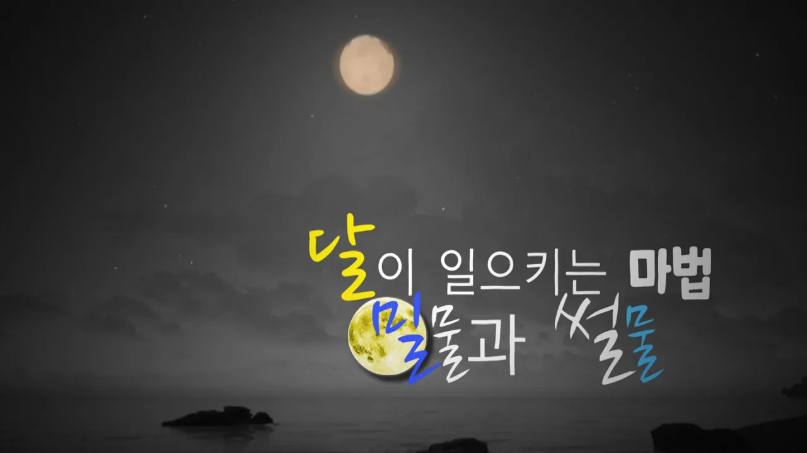

# [해양상식] 달이 일으키는 마법, 밀물과 썰물(조석현상)

## 기본 정보
- **URL**: https://www.youtube.com/watch?v=0GGd9tdGha8
- **채널명**: 해양예보방송 On바다
- **구독자수**: 3만
- **조회수**: 72,691
- **업로드일**: 2022-10-17
- **영상 길이**: 4:24
- **댓글 수**: 264
- **좋아요 수**: 1,055

## 썸네일

---

## 댓글 (추천순 TOP 10)

| 순위 | 좋아요 | 댓글 |
|------|--------|------|
| 1 | 7 | 달이 일으키는 마법, 밀물과 썰물 마법사는 달의 과학이라는 것을 재확인하는 계기가 되었습니다^^ |
| 2 | 4 | 마법같은 일이 우리 바다에서는 매일매일 일어나니 더 신기하게 느껴지는 것 같아요. 교육적으로도 좋고 즐거운 시간도 보낼 수 있는만큼 많은분들이 찾아주시길 희망합니다. |
| 3 | 2 | 밀물과 썰물을 재밌게 설명해 주셨네여 ㅎㅎㅎ  영상 재밌게 보고 갑니다 ^^ |
| 4 | 1 | 앞으로 갯벌체험은 국립해양조사원 >스마트조석예보를 꼭 확인할게요 !! |
| 5 | 1 | 갯벌체험은 조석정보를 꼭 확인해서  안전하게  즐겨요 |
| 6 | 1 | 잘 시청했습니다    스마트조석예보 좋아요 |
| 7 | 1 | [해양상식] 달이 일으키는 마법, 밀물과 썰물 정말 마음에 듭니다. |
| 8 | 4 | 쪼꼬미 아이들이 갯벌체험 하는모습을 보니 정말 사랑스럽네요ㅎ 저 또한 경험해본적이 있어서 그런지 낯설지가 않은데 밀물과 썰물에 대한 원리를 정확하게 알아갈수 있어서 유익했는데요 이처럼 조석예보 확인을 통해 많은분들이 안전하게 즐길수 있기를 바래봅니다 |
| 9 | 2 | 달이 일으키는 마법 ᆢ밀물 썰물 ᆢ신기하네요. 어릴때는 무조건 수업시간에 외우기만 해서 어렵게만 느껴졌는데, 갯벌체험이라는 실생활에 접목해서 이해하니 훨씬 더 이해가 잘되는것 같습니다 |
| 10 | 2 | 지구와 우주의 신비가 같이 합쳐진 밀물과 썰물 ~  신기한 일이지만 지나치면 위험하듯이 항상 시간잘 생각하고  갯벌체험에 임해야겠습니다. 우리아이들에게 정말로 중요하고 유익한 교육적인 영상이네요 . |
