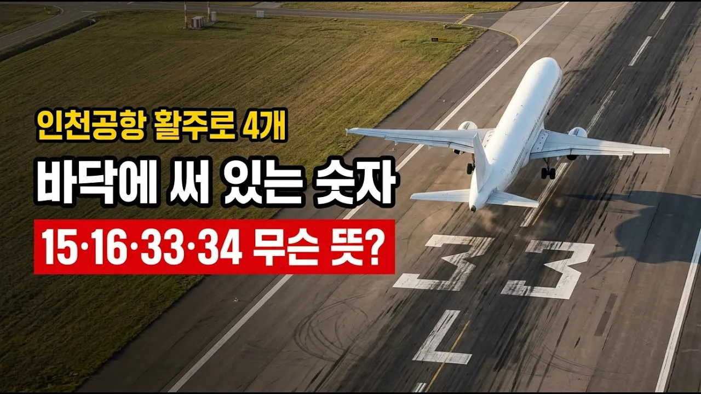

# [궁금한 건축] 인천공항 활주로 바닥의 숫자 15·33, 무슨 뜻일까?

## 기본 정보
- **URL**: https://www.youtube.com/watch?v=tKXLHi7yDKI
- **채널명**: 궁금한 건축
- **구독자수**: 6,020
- **조회수**: 256,425
- **업로드일**: 2026-10-13
- **영상 길이**: 17:25
- **댓글 수**: 19
- **좋아요 수**: 1,095

## 썸네일

---

## 댓글 (추천순 TOP 10)

| 순위 | 좋아요 | 댓글 |
|------|--------|------|
| 1 | 8 | 활주로 진입 방향을 알려주는 숫자죠. |
| 2 | 3 | 대충 알고 있었는데 자세하게 알았습니다. 물어보는 사람 있으면...  잡다한 상식 늘 잘 보고 있습니다. |
| 3 | 0 | 제주공항도 메인 활주로가 원래 06/24에서 07/25로 바뀌었다고 하네요. 그리고 제주도민으로 육지 다녀올때 늘 급변풍 걱정을 한답니다. 어려운 용어 없이 쉽게 설명해 주셔서 재밌게 잘 봤습니다 ❤ |
| 4 | 9 | 일반인이 알 필요는 느끼지 않지만 방향의 숫자였군요, |
| 5 | 4 | 요즘엔 압력차에 의한 양력의 원리를 부정하던데요 우세해진 원리는 받음각과 관련있다고 하는데 전 들어도 정확히는 이해가 어렵더라구요 |
| 6 | 1 | 제목은 건축.. 내용은 유체역학.. |
| 7 | 5 | 다들 베르누이 법칙에 의해서 만들어진 양력이라는 얘길 많이 하는데 베르누이 법칙만 있는것도 아니고 뉴턴의 운동법칙도 같이 들어가서 서로 다른 방식으로 나타내는 현상이 비행기가 뜨는 법칙이죠...   여기서 유체역학까지 들어간다면...ㄷㄷㄷ |
| 8 | 0 | 그래서 왜 방향를 알려죠야되는데 |
| 9 | 4 | 즉 받음각이 비행기를 상승 시키는거, 항공기를 아는 사람은 다 알고 있는 사실인데 그놈의 베르누이 정리가 그동안 발목을 잡았다.헬기가 상승 하는건 거의100% 블레이드의 받음각이 결정 합니다. |
| 10 | 0 | 로또 번호입니다 |
