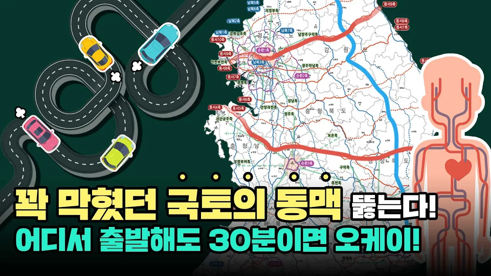

# 7*9 10*10, 도로에 있는 숫자는 무엇을 의미할까?

## 기본 정보
- **URL**: https://www.youtube.com/watch?v=YIG8xofsAds
- **채널명**: 국토교통부
- **구독자수**: 27만
- **조회수**: 205,965
- **업로드일**: 2021-10-18
- **영상 길이**: 6:41
- **댓글 수**: 122
- **좋아요 수**: 1,653

## 썸네일

---

## 댓글 (추천순 TOP 10)

| 순위 | 좋아요 | 댓글 |
|------|--------|------|
| 1 | 38 | 백두대간이 지나가는 강원도, 경북 북부지역은 아직도 횡축 도로가 너무 빈약합니다. 국토 균형발전이라고 해서 서해안, 남해안 섬 지역에만 천문학적인 공사비를 투자할 것이 아니라 이 지역에도 고속도로가 절실합니다. 도로라도 있어야 유령도시를 면하든, 관광객들이라도 오든 하지 않을까요... |
| 2 | 10 | 여기가 그래서 지금껏 오지중오지였죠  대구 춘천 중앙고속도로를  몇십번 이용하는 사람으로  강원도 쪽과  경북 있는 세로축 고속도도 한시바삐 개통되야 합니다 |
| 3 | 6 | 2029 영양ㆍ안동 동계 유니버시아드 유치 추진으로 2024 강원 동계 청소년올림픽 개최지역과의 종축 도로 연결도 서둘러야 합니다! |
| 4 | 3 | 속리산 접근성을 높여 전국민이 편리하게  이용할 수 있길 바랍니다. |
| 5 | 2 | 31번국도, 36번국도, 35번국도 등 이곳을 지나는도로4차로 확충이 됐으면합니다. 수요없다고 예산많이든다고 애매한 왕복2차로 직선화만 시키는공사 이런건 돈낭비입니다. |
| 6 | 4 | 5년전 전라도 가보니깐    도로 거미줄 바둑판같이 4차선 국도 고속도로 도로망  전라도 정말  잘되어 있습니다   ㅡ강원과 경북 두지역이  정말  낙후됐죠 |
| 7 | 9 | 울진 보세요 어느 지역이든 갈려면 돌아버리겠습니다 |
| 8 | 8 | 드라이브를 즐기는 1인으로서, 아주 기쁜 소식이네요. 더욱 더 도로환경이 좋아지는 대한민국! |
| 9 | 6 | 이것도 좋은일이긴 한데 대도시권 상습 정체구간부터 좀 해결해줬으면... |
| 10 | 2 | 진천~합천간 고속도로가 보은군을 경유한다는데 속리산과 접근을 용이하게 건설하여 전국 중앙에 위치한 국립공원의 자연을 전 국민이 편리하게 이용할 수 있도록 하여 주시면 고맙겠습니다. |
