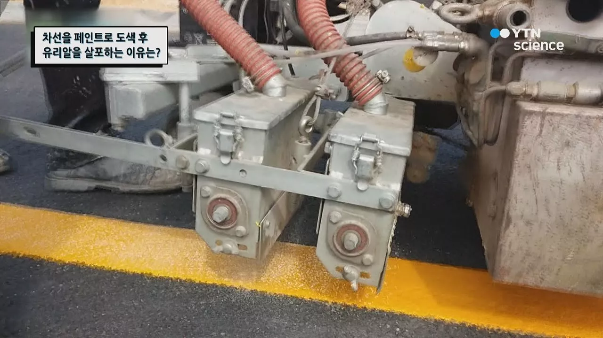

# 차선을 페인트로 도색 후 유리알을 살포하는 이유는? / YTN 사이언스

## 기본 정보
- **URL**: https://www.youtube.com/watch?v=uz9INdKrwJM
- **채널명**: YTN 사이언스
- **구독자수**: 86만
- **조회수**: 19,933
- **업로드일**: 2018-02-01
- **영상 길이**: 3:17
- **댓글 수**: 18
- **좋아요 수**: 69

## 썸네일

---

## 댓글 (추천순 TOP 10)

| 순위 | 좋아요 | 댓글 |
|------|--------|------|
| 1 | 11 | 일본은  고급형을  써서 오래간다고  하더군. 한국은  저가형을 써서 금방  지워진다고... |
| 2 | 1 | 넣질 않아서 그래요 ㅋㅋ 고가형 저가형이 어딨음..애초에 비오면 보이지도 않구만 |
| 3 | 0 |  @hdhsbshsudbfm  일반형 고휘도 우천형 차이는 있습니다. 일반 사급으로 견적넣으시는분들은 이왕 하는거 좋은걸로 합시다 하시는 반면에 관급, 그러니까 관공서 뭐 이런쪽에선 싼가격에 고퀄리티를 원하시니 차이가 100프로 아니 10000프로 있지요 |
| 4 | 0 |  @여섯시내고환-y8s  우천형비드가 근본적으로 내구성이 떨어집니다...3M 제품을 사용합니다. 고가~~~ 돈없는 자치단체에서는 사용도 못하고요....1kg당 = 32,000원이 넘어요. 그런데 6개월이상 가질못해요... |
| 5 | 0 | 저가형을써서 지워 지는게 아니고 비싼거 써도 우리나라 기술로는 어쩔수 없음 |
| 6 | 1 |  @유동진-m8f   기술이  없는게  아니고 비용적은것  선택해서 그렇다고  방송에  나왔었음. 어디  아날로그  나라와 비교를... |
| 7 | 0 |  @시간의주마등  유리알은 페인트가 얼마나 잘 잡고있어주냐의 문제임.... |
| 8 | 1 |  @유동진-m8f  기술문제가 아니라 융해도 안된 재료에 비드를 얹히면 유리알이 먹겠습니까 기본적으로 생각좀 합시다 |
| 9 | 0 | 그래 일본은 어떤 도로표지용페인트 와 글라스비드를 사용하나요..? 대한민국도 도료표지용 페인트 기준을 유럽기준으로해서 적용중인데.. 도료표지용 페인트 개발자로서 궁금해서 물어봅니다.... |
| 10 | 1 | 진짜 우리나라는 유리알을 조금씩 너요 그래서 빨리 지워져요. |
