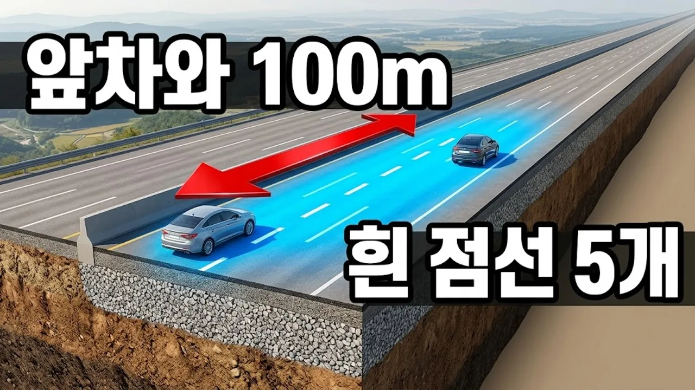

# 고속도로 점선 하나는 8m, 앞차와 100m는 다섯 개다

## 기본 정보
- **URL**: https://www.youtube.com/watch?v=xIbkxd0eY8g
- **채널명**: 1분 도시
- **구독자수**: 34
- **조회수**: 439
- **업로드일**: 2026-10-01
- **영상 길이**: 5:11
- **댓글 수**: 2
- **좋아요 수**: 1

## 썸네일

---

## 댓글 (추천순 TOP 10)

| 순위 | 좋아요 | 댓글 |
|------|--------|------|
| 1 | 0 | 안녕하세요 영상잘보구 갑니다.2.5배기량에 4륜은 크루즈얼마 놓아야 연비 좋나요? |
| 2 | 0 | 영상 봐 주셔서 감사합니다. 연비가 가장 좋은 크루즈 속도는 차종마다 달라서 이번 영상에서는 다루지 못했어요. 다만 시속 100km로 맞추신다면 앞차와는 흰 점선 다섯 개, 100m를 두시는 게 도로공사 권장 거리입니다. |
