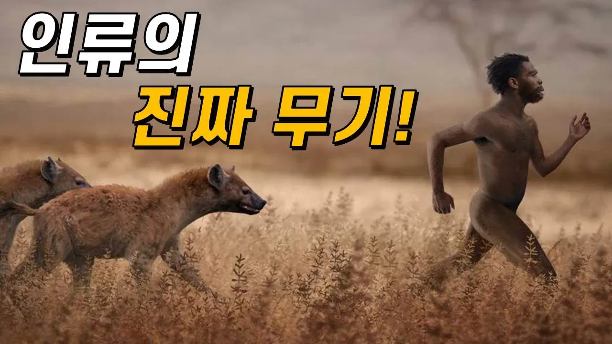

# 인류는 어떻게 게임 체인저가 됐을까?｜인간의 놀라운 신체 능력!

## 기본 정보
- **URL**: https://www.youtube.com/watch?v=j6R7omxhwXg
- **채널명**: 과학드림 [Science Dream]
- **구독자수**: 115만
- **조회수**: 1,338,567
- **업로드일**: 2023-03-10
- **영상 길이**: 6:49
- **댓글 수**: 1,000
- **좋아요 수**: 14,714

## 썸네일

---

## 댓글 (추천순 TOP 10)

| 순위 | 좋아요 | 댓글 |
|------|--------|------|
| 1 | 19 | 저의 2번째 책 <과학드림의 무섭게 빠져드는 과학책>이 출간되었습니다! 늘 잊지 않고 채널 찾아와 주셔서 감사합니다. 글과 만화가 잘 어우러져 있어 쉽게 읽힐 거예요. 그리고 아마 영상과는 또 다른 매력을 느끼실 거라 생각됩니다.😊 - 과드 올림 - 교보문고: http://gilbut.co/c/23107681td
 - 예스24: http://gilbut.co/c/23106761WL
 - 알라딘: http://gilbut.co/c/23105727Lw |
| 2 | 1 | 2가지가 아니라 3가지겠지 바로 지능 |
| 3 | 1,100 | 여름만되면 육수 뿜뿜인 내가 사실은 진화의 산물...?😎😎 |
| 4 | 33 | 여름에 육수를 뿜뿜하도록 진화하지 않았다면 익어서 돌아가셨을 테니 맞긴 하네용 |
| 5 | 24 | 라는 애니 추천좀 |
| 6 | 15 | 머리 위쪽까지 털이 없지는것도 진화의 산물?! |
| 7 | 2 | ​ @Vintorezer  아뇨 그건 그냥대머리입니다 |
| 8 | 1 | ​ @Vintorezer  유전적으론 맞긴해ㅋㅋ |
| 9 | 10 | 웃자고 쓴 댓글에 쿨찐들 꼬인거보소 |
| 10 | 0 |  @보쿠타치와모에사카루  인정 |
