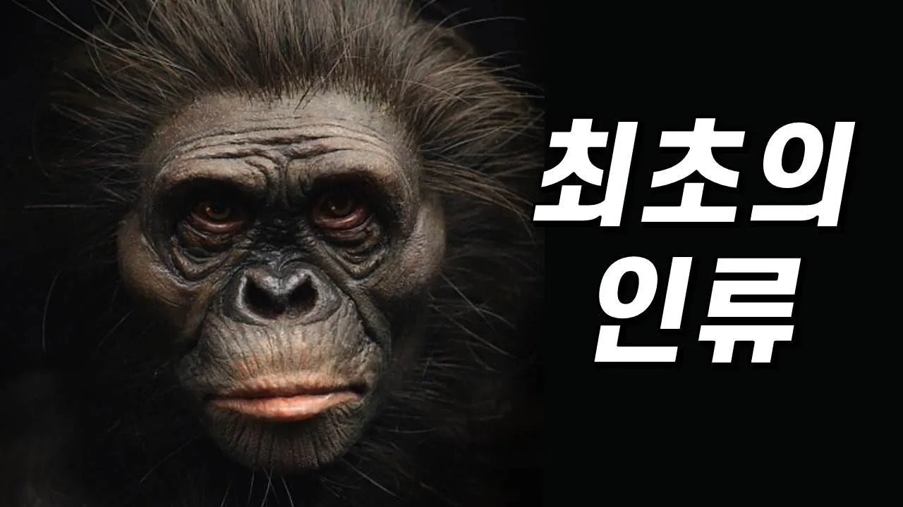

# 최초의 인류, 오스트랄로피테쿠스는 어떻게 살았을까?

## 기본 정보
- **URL**: https://www.youtube.com/watch?v=ZlNs2WcKquY
- **채널명**: 과학드림 [Science Dream]
- **구독자수**: 115만
- **조회수**: 1,678,991
- **업로드일**: 2022-05-13
- **영상 길이**: 11:07
- **댓글 수**: 1,100
- **좋아요 수**: 17,484

## 썸네일

---

## 댓글 (추천순 TOP 10)

| 순위 | 좋아요 | 댓글 |
|------|--------|------|
| 1 | 644 | 저의 첫 신간, <과학드림의 이상하게 빠져드는 과학책>이 나왔습니다. 3년간 꾸준히 채널을 시청해 주시고 아껴 주신 모든 분들 덕분입니다. 저의 오랜 꿈을 이룰 수 있게 해 주셔서 진심으로 감사합니다. 출간 준비 때문에 영상이 많이 늦었어요. 죄송합니다.ㅠ  위트 있는 만화와 글이 잘 어우러진 책입니다. 많은 관심 부탁드리며, 종종 즐거운 이벤트로 인사드리겠습니다. 지금 구매하시는 분들은 선착순으로 제 친필 사인이 담긴 책을 받아보실 수 있다고 하네요. 헤헤. -과드 올림.  [도서 구매링크] 예스24 http://gilbut.co/c/22056120RA 교보문고 http://gilbut.co/c/22054992iE 알라딘 http://gilbut.co/c/22057332ci  P.S - 75만 감사합니다♥ 그나저나 재미삼아 영상 속에 오래된 구독자분들만 알 수 있는 이스터에그를 숨겨 봤어요. 흐흐^^ |
| 2 | 9 | 3:15 즈음에 드림님 예전 로고 아닌가요? |
| 3 | 1 |  @미니4호  와...대박! 저에게 메일로 주소와 연락처를 보내 주세요~! 공룡 캐릭터가 그려진 유리컵을 선물로 드리고 싶습니다! :) |
| 4 | 1 |  @ScienceDream  그거 독을가진 동물들이 있잖아요 동물이 독을어떻게 가지게 되었는지 독을가진동물의 진화에대해서 영상올려주실수있나요? |
| 5 | 7 | 출판 축하드려용 ㅎㅎ 근데 책사면 영상 자주 올라오나요? ㅋㅋㅋ |
| 6 | 5 | 질문있습니다 저가 학교 다닐 때 두발로 뛸 수 있어야 사람이라 인정한다고 배웠는데 원숭이나 침팬지는 흥분하면 네발로 뛰는 것 때문에 해당이 안된다던대 타조는 손과 팔이 날개고 다리로 뛰는 게 맞지 않나요? |
| 7 | 3 |  @로키-z7f  루시같은 인류조상의 직립보행과 침팬지의 보행은 다릅니다. 2:08 보시면 나와요 |
| 8 | 0 |  @로키-z7f  '영장류 중에서'라는 전제가 붙겠죠. 조류는 일단 조류니까요... |
| 9 | 0 |  @로키-z7f  닭도 두발로 뛰지만 포유류라고 인정되지 않는 조류 입니다. 조류의 특성과 포유류의 특성을 조금만 더 생각해 보시길 바랍니다. |
| 10 | 4 | 출간 축하드립니다^^승승장구하세요!! |
