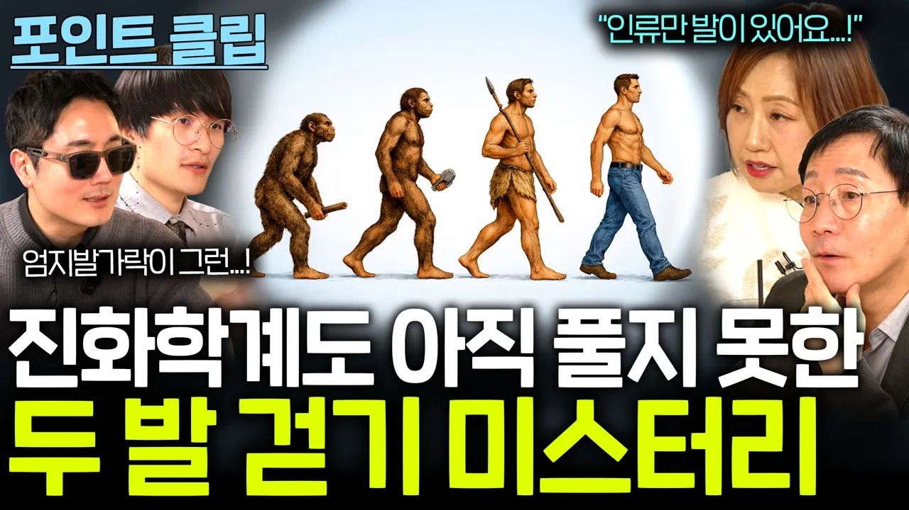

# 인류학계에서 아직 풀지 못한 인류 진화 미스터리... (엄지발가락의 위대함...?)

## 기본 정보
- **URL**: https://www.youtube.com/watch?v=R-_XHcJHQAU
- **채널명**: 과학을보다
- **구독자수**: 24만
- **조회수**: 41,348
- **업로드일**: 2026-03-14
- **영상 길이**: 11:36
- **댓글 수**: 110
- **좋아요 수**: 829

## 썸네일

---

## 댓글 (추천순 TOP 10)

| 순위 | 좋아요 | 댓글 |
|------|--------|------|
| 1 | 11 | 오디오 변경해서 다시 올렸군요 오늘 또 하나의 지식을 가지고 갑니다. 역시 유익한 체널입니다. |
| 2 | 9 | 아니 이거 개꿀잼이네 |
| 3 | 2 | 두발 걷기만 미스테리일까? 생명체의 발생 자체가 미스테리. |
| 4 | 9 | 존잼 |
| 5 | 1 | 아 풀버전 .. |
| 6 | 0 | 지난번  스토리 재 업로드지만  교수님 똑소리 나십니다 견적이란 용어도 시의적절합니다 ㅎ |
| 7 | 0 | 지구력 향상 때문일듯 |
| 8 | 0 | 앞발로는 도구들고 뛰어다니며 사냥을 했으니깐 자연스럽게 그쪽이 우세하게 대를 이은거 같은데 |
| 9 | 2 | 8:50 전통성->정통성 |
| 10 | 0 | 육식이 아닌 초식동물을 상대하다보니 장거리로 추격해서 지치게 만들어 잡아먹다보니 걷는게 보편화되지 않았을까 하는 추측 |
