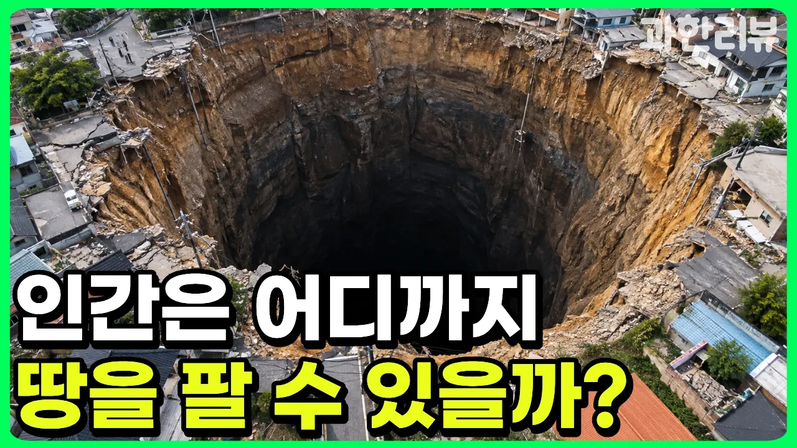

# 2026년 마침내 맨틀 뚫린다? 인류가 37년째 지하 12km를 넘지 못하는 진짜 이유

## 기본 정보
- **URL**: https://www.youtube.com/watch?v=jVGQETMJFHU
- **채널명**: 과한리뷰
- **구독자수**: 8,750
- **조회수**: 25,269
- **업로드일**: 2026-10-13
- **영상 길이**: 15:41
- **댓글 수**: 22
- **좋아요 수**: 76

## 썸네일

---

## 댓글 (추천순 TOP 10)

| 순위 | 좋아요 | 댓글 |
|------|--------|------|
| 1 | 2 | 구멍이란 단어는 항상 설레이네요. |
| 2 | 1 | 엿보기 구멍은 인간의 본성인가 |
| 3 | 0 | 그러니깐 저게 땅따먹기를 한 흔적이라는 거죠? 어흐 |
| 4 | 0 | 언옵테니움과 50조 정도의 비용이 있으면 지구의 외핵까지..... ㅋㅋ |
| 5 | 0 | 선생님 러시아가 가장깊게 땅을 팠다까지만 이해했습니다 더이상 진도 나가기가 어렵습니다 |
| 6 | 0 | 천천히 여러번 시청해주시면 저의 건강에 좋습니다 |
| 7 | 0 | 기장 깊은 구멍은... 엿보기 구멍이 아닐까요? 고의로 본거면 깊은 곳으로 대려가는... 구멍... |
| 8 | 0 | 심연을 들여다보면 어느새 심연이 우리를 들여다보고있죠...❤ |
| 9 | 0 | tts 목소리 좋다 이목소리 모에요? |
| 10 | 0 | 제일 흔한 목소리에 극한의 후가공을 곁들였습니다! |
