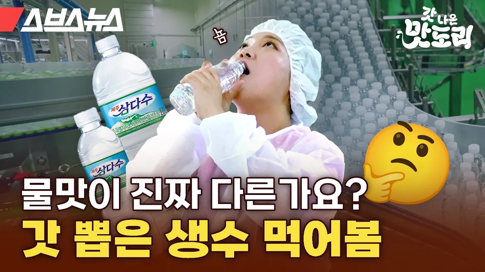

# "오늘 공장에서 먹는 물이 18년 전 내린 빗물이라고요?" 생수 1티어 삼다수의 비밀 [갓 나온 맛도리 EP.87] / 스브스뉴스

## 기본 정보
- **URL**: https://www.youtube.com/watch?v=K5AYgsXx6Js
- **채널명**: 스브스뉴스 SUBUSUNEWS
- **구독자수**: 143만
- **조회수**: 241,443
- **업로드일**: 2024-07-31
- **영상 길이**: 6:17
- **댓글 수**: 172
- **좋아요 수**: 4,272

## 썸네일

---

## 댓글 (추천순 TOP 10)

| 순위 | 좋아요 | 댓글 |
|------|--------|------|
| 1 | 28 | 세상의 모든 먹트렌드는 이곳에서! 
 <갓 나온 맛도리> 매주 수요일에 만나요~
 
 ▽지난 에피소드▽ "가속노화 전문가이시네요" 저속노화 교수님한테 손절당한 루나 PD 근황 https://youtu.be/LYzS__lGpvs?si=_RVDOj6w2KH3iOZj |
| 2 | 0 | 스포츠 탐탐 : 37편 이벤트 당첨자인데 댓글하면 전부 삭제됩니다. 확인 부탁드려요~ 다른 접수방법 좀 알려주세요. |
| 3 | 157 | 삼다수 구매할 때마다 주소를 왜 크게 적어뒀지 궁금했는데, 그만큼 물 품질에 자신이 있었던 거구나. 믿고 마십니다 역시!! |
| 4 | 0 | 삼다수 직원이세요? |
| 5 | 0 | 직원인가 봄 |
| 6 | 0 | 누구지? 문수형 팀장인가? ㅋㅋ |
| 7 | 20 | 그건 아니고 관련 법규때문에 그럼  먹는샘물등의 기준과 규격 및 표시기준 고시  제10조(표시사항) 먹는샘물등의 표시사항은 다음 각 호와 같다.  
 1. 품목명 
 2. 제품명 
 3. 원수원 및 수원지 
 4. 업소명 및 소재지 
 5. 유통기한 
 6. 영업번호 
 7. 내용량 
 8. 무기물질함량 
 9. 기타 세부 표시기준에서 정하는 사항    마. 나목 및 다목에 따른 수원지 글자크기는 주 표시면의 제품명 글자크기(가장 큰 글자크기를 기준으로 한다)의 1/2이상 크기(높이와 폭을 말한다)로 표시해야 하며, 도로명주소(도로명주소로 표시할 수 없는 경우 지번방식의 주소)는 1/6이상 크기로 표시할 수 있다. |
| 8 | 12 | 삼다수가 비싸긴한데 그만큼 깔끔하긴 함. 이상하게 저렴한 물 마셨는데 뭔가 그 특유의 미끌거리면서 엄청 살짝 비릿한? 그런 느낌이 드는게 그거 석회질이라고 하던데 |
| 9 | 69 | 영상이 뭔가 착각을 일으키는 내용을 포함하고 있는데 수원지를 크게 써놓은 건 자부심? 그런거 때문이 아님. 법규가 그래서 그런거임  먹는샘물등의 기준과 규격 및 표시기준 고시
 
 제10조(표시사항) 먹는샘물등의 표시사항은 다음 각 호와 같다.  
 1. 품목명 
 2. 제품명 
 3. 원수원 및 수원지 
 4. 업소명 및 소재지 
 5. 유통기한 
 6. 영업번호 
 7. 내용량 
 8. 무기물질함량 
 9. 기타 세부 표시기준에서 정하는 사항   먹는샘물등의 기준과 규격 및 표시기준 고시  먹는샘물등의 세부 표시기준
 (제11조 관련)
   마. 나목 및 다목에 따른 수원지 글자크기는 주 표시면의 제품명 글자크기(가장 큰 글자크기를 기준으로 한다)의 1/2이상 크기(높이와 폭을 말한다)로 표시해야 하며, 도로명주소(도로명주소로 표시할 수 없는 경우 지번방식의 주소)는 1/6이상 크기로 표시할 수 있다. |
| 10 | 6 | SBS도 가짜뉴스가 심하네요 |
