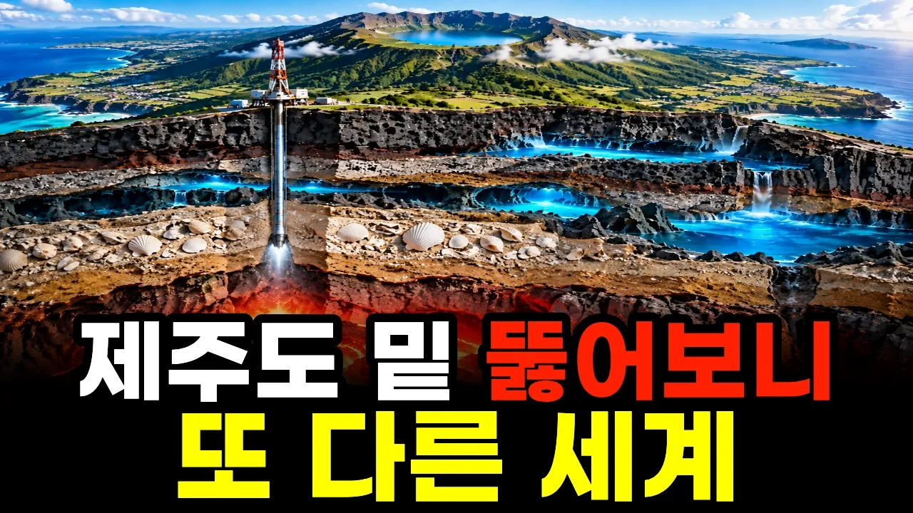

# 제주도 아래에는 무엇이 있을까｜실제로 뚫어 본 한라산 밑

## 기본 정보
- **URL**: https://www.youtube.com/watch?v=RGplzouVeSI
- **채널명**: 심층과학
- **구독자수**: 2,760
- **조회수**: 557,208
- **업로드일**: 2026-10-04
- **영상 길이**: 18:03
- **댓글 수**: 42
- **좋아요 수**: 1,889

## 썸네일

---

## 댓글 (추천순 TOP 10)

| 순위 | 좋아요 | 댓글 |
|------|--------|------|
| 1 | 17 | 그래서 삼다수가 좋은 물이구나 32년전 빗물이 자연정화된 물 |
| 2 | 1 | 영상 속 이야기를 재미있게 연결해 주셨네요~ 함께 봐주셔서 감사합니다😊 |
| 3 | 1 | 물이 깨끗하고 맑아요 맛도좋고 바다밑에서 올라와서 섬이됐죠:cat-orange-whistling: |
| 4 | 0 | 제주 물이 맑고 맛도 좋다는 말씀, 반갑습니다~ 섬이 생겨난 이야기까지 함께 봐주셔서 감사합니다 :) |
| 5 | 5 | 신비롭고 고마운 땅덩어리 지구! |
| 6 | 0 | 발밑 땅이 참 신비롭지요~ 반갑습니다😊 |
| 7 | 0 | 재밋음 ᆢ |
| 8 | 0 | 재미있게 봐주셔서 감사합니다😊 |
| 9 | 7 | 오후 늦게 큰엉 절벽에서 붉어지는 햇살아래 부서지는 파도를 봤던게 인상이 깊었음 |
| 10 | 0 | 큰엉 절벽의 저녁 햇살과 파도, 눈앞에 그려지듯 생생하네요! 좋은 기억 나눠주셔서 감사합니다 |
