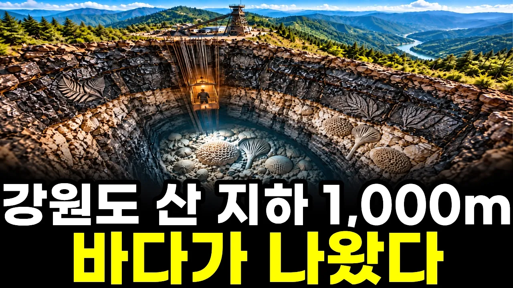

# 강원도 산을 1,000m 파 내려가자 바다가 나왔습니다｜실제 탄광 갱도 끝에 묻혀 있던 숲과 바다

## 기본 정보
- **URL**: https://www.youtube.com/watch?v=mEiUpMcVyF0
- **채널명**: 심층과학
- **구독자수**: 3,000
- **조회수**: 92,982
- **업로드일**: 2026-10-16
- **영상 길이**: 19:03
- **댓글 수**: 17
- **좋아요 수**: 678

## 썸네일

---

## 댓글 (추천순 TOP 10)

| 순위 | 좋아요 | 댓글 |
|------|--------|------|
| 1 | 4 | 연탄불 꺼뜨린 날, 옆집에 불붙은 연탄 한 장 빌리러 가 보신 적 있으신가요? 골목에 쌓이던 하얀 연탄재, 아랫목의 뜨끈함, 겨울 아침 연탄 갈던 집게까지… 그 검은 원통 하나에 우리 겨울이 다 들어 있었죠. 강원도에서 자라신 분이라면 돌을 쪼갰다가 잎 무늬를 보신 적도 있을 겁니다. 여러분의 연탄 겨울은 어떤 장면으로 남아 있나요?❄️ |
| 2 | 6 | 태백에 살았던 사람으로 화석 이야기는 공감이 가네요. 버려진 석탄 덩어리를 망치로  깨면 식물 화석이 나오고, 냇가의 돌을 깨면 어류 화석이 나왔어요. |
| 3 | 1 | 태백에서 직접 석탄 덩어리를 깨 보신 분의 이야기라 더 반갑습니다! 영상에서 말한 그 잎 무늬를 손으로 쪼개 보셨던 거네요~ 귀한 기억 나눠 주셔서 감사합니다🙏 |
| 4 | 6 | 석탄기라는 시대가 있었는데..식물이 엄청 번성하던 시기였음..다만 아직 세상에는 식물을 소화시키거나 썩게하는 생물도 세균도 없었음..식물이 썩지못하니 계속 쌓였고 그 쌓인 식물들이 땅속으로 들어가 탄화된게 지금에 석탄임.. 다시금 말하자면 나무나 풀을 썩게하거나 분해시킬 수 없었음..왜냐면 그럴수있는 세균이 아직 세상에 나타나지 않음거임.. |
| 5 | 0 | 석탄이 생긴 까닭을 한 번 더 풀어 주셨네요~ 영상에서는 늪의 물속에 쓰러져 흙과 모래에 덮이고 오랫동안 눌린 시간을 그 까닭으로 따라갔습니다. 좋은 이야기 보태 주셔서 감사합니다 :) |
| 6 | 3 | 조선누군층에서는 석회암이 평안누군층에서는 석탄이 나온다고 하네요 . 그 당시 영월은 200m 정도 깊은 바다였고 태백은 3~40m 오늘날 서해와 같은 얕은 바다였다고 합니다.  영월과 태백의 직선 거리가 지금은 약 46km 정도 인데 .. 5억년 전에는 1천km 떨어진 거리에 있었다고 하니... 영원한 것은 지구상에 없네요.. |
| 7 | 0 | "영원한 것은 지구상에 없다"는 말씀이 오늘 영상의 결론이기도 하지요~ 석회암 바다와 석탄 숲을 나눠 짚어 주신 덕에 저도 한 번 더 정리가 됐습니다. 좋은 이야기 보태 주셔서 감사합니다😊 |
| 8 | 1 | 970m 승강기 굴을 타고 내려간다는 상상만으로도 숨이 막히는데, 막장 벽에서 돌을 쪼개 화석 나뭇잎 자국을 찾아내는 장면이 압권이었습니다. 댓글에서 태백이 3~40m 깊이의 얕은 바다였다는 설명까지 읽고 나니, 연탄 한 장이 결국 바닷속에 묻혔던 숲의 시간을 태운 거였다는 게 실감 나네요. 벽의 검은 무늬가 단순한 얼룩이 아니라 고생대 바다의 기록이었다니 놀랍습니다. |
| 9 | 0 | 막장에서 돌을 쪼개는 장면을 좋게 봐 주셔서 기쁩니다~ 영상에서는 검은 무늬 쪽이 늪에 쓰러져 눌린 숲이었고, 바다는 그 아래 회색 돌에서 산호로 나왔습니다. 연탄 한 장에 담긴 숲의 시간을 실감해 주셔서 감사합니다🙏 |
| 10 | 1 | Ai가 연탄집게가 어떻게 생겼는지 모르네요. |
