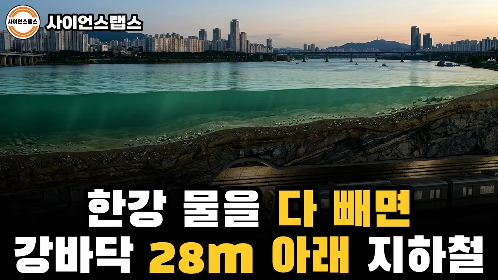

# 한강 물을 다 빼면 드러나는 것들 | 강바닥에서 나온 6·25 폭탄, 바위까지 박힌 다리 기둥

## 기본 정보
- **URL**: https://www.youtube.com/watch?v=zukoA_dG91E
- **채널명**: 사이언스랩스
- **구독자수**: 7만
- **조회수**: 20,585
- **업로드일**: 2026-10-15
- **영상 길이**: 15:25
- **댓글 수**: 6
- **좋아요 수**: 101

## 썸네일

---

## 댓글 (추천순 TOP 10)

| 순위 | 좋아요 | 댓글 |
|------|--------|------|
| 1 | 0 | 한강 물을 다 빼 보니, 가장 놀라웠던 건 어느 거였나요?  1. 강바닥 7m 아래에서 60년 넘게 잠들어 있던 6·25 폭탄 2. 강바닥 평균 28m 아래를 달리는 지하철 5호선 3. 모래를 퍼 가서 통째로 사라진 섬 저자도 4. 폭파됐다가 6배 넘게 커진 밤섬  댓글로 번호와 이유를 남겨 주세요. 다음에 물을 빼 보고 싶은 강이나 호수도 환영합니다. |
| 2 | 2 | 서울에서 태어나고 자란 옛 어르신들은 영상을 보시며 옛기억에 감회가 새롭겠네요...^^  지금은 서울에 살진 않지만, 그래도 25년을 살았었는데,, 한강에 이런 숨은 이야기들이.... 여튼, 이런 영상들 너무 좋습니다.~!! |
| 3 | 0 | 잘 보셨다니 너무 좋습니다. 😊 |
| 4 | 3 | 영상 재밌게 보고 있는데 음악 소리가 집중력을 방해해요. 설명하는 소리를 들어야 되는데 음악 소리가 상당히 귀에 거슬리네요. |
| 5 | 0 | 앗.  알겠습니다. 조치 하겠습니다. |
| 6 | 0 | 깎고쌓이는 위치가 이상해요 13:30 |
