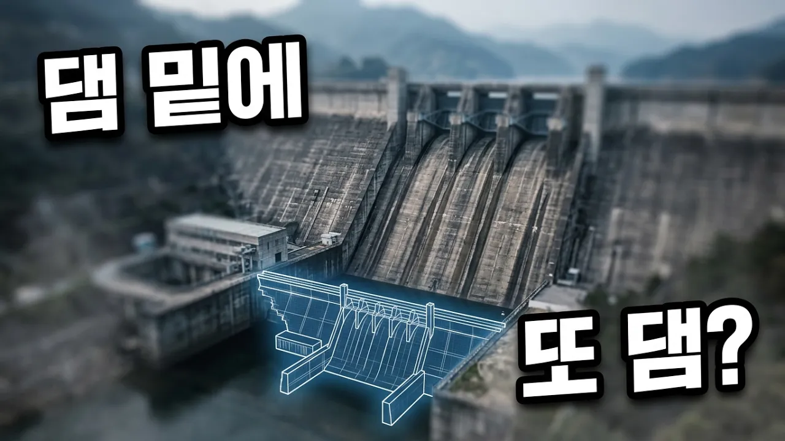

# 소양강댐 짓고 5년 만에 정반대로 지은 댐, 충주댐은 왜 댐 밑에 댐을 하나 더 뒀을까

## 기본 정보
- **URL**: https://www.youtube.com/watch?v=5NdX1p3y4e0
- **채널명**: 신비한 건축사전
- **구독자수**: 81만
- **조회수**: 423,598
- **업로드일**: 2026-09-07
- **영상 길이**: 6:05
- **댓글 수**: 71
- **좋아요 수**: 990

## 썸네일

---

## 댓글 (추천순 TOP 10)

| 순위 | 좋아요 | 댓글 |
|------|--------|------|
| 1 | 69 | 이사람만큼 3d 영상 제작을 잘 활용하는 사람이 드문듯 |
| 2 | 1 | 이쇼츠 볼떄마다 너무 소름돋음 너무 미치겟음.. |
| 3 | 1 | Ai니깐 |
| 4 | 0 | 3d가 더 헷갈리게 만듬 만들려면 제대로 만들어야지 |
| 5 | 0 | 충주댐 유역주민들 고충을 수도권 사람들은 알아주길 바란다 잦은안개로 농작물피해.상수도 보호구역으로 개발제한 재산권침해를 받고있다 집중호우때   수도권 막아줘 충주댐물 94%가 수도권에서 쓰고 있다 그러나 피해주민들에겐 혜택이라곤 하나도 없다 심지어 수도요금도 수도권과 동일하게 적용한다 |
| 6 | 0 | 수도권 대기업들이 벌어온 돈으로 시골 사람들 잘 먹고 살잖아 |
| 7 | 0 |  @호호호-k1s  ??? |
| 8 | 22 | 도데체 빚이 얼마길래..... |
| 9 | 0 | zzzzzzzzzzzzzz |
| 10 | 0 | 이쇼츠 볼떄마다 너무 소름돋음 너무 미치겟음.. |
