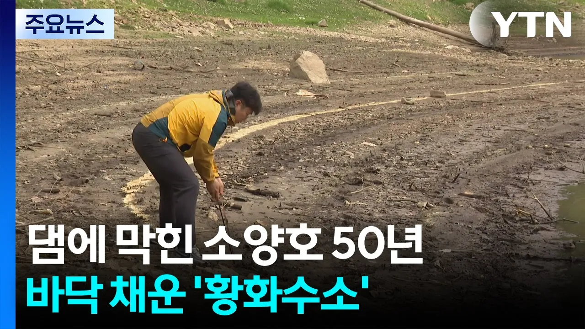

# 댐에 막힌 소양호 50년...바닥 채운 '황화수소' / YTN

## 기본 정보
- **URL**: https://www.youtube.com/watch?v=vYpdId777aA
- **채널명**:  YTN
- **구독자수**: 542만
- **조회수**: 152,085
- **업로드일**: 2026-05-20
- **영상 길이**: 2:30
- **댓글 수**: 267
- **좋아요 수**: 827

## 썸네일

---

## 댓글 (추천순 TOP 10)

| 순위 | 좋아요 | 댓글 |
|------|--------|------|
| 1 | 28 | 진짜 어민분들이 먼저 아신게 경험으로 쌓은 지혜의 힘이다. |
| 2 | 203 | 과잉 비료 사용    축사 분뇨    등이 강에 수십년 녹아 바닥에 쌓이고 쌓이고 ... |
| 3 | 11 | 원인을 알고 있네요. 주위 축사 분뇨 제대로 처리하고 오염물질이 바로 호수로 유입되지 않게 해야죠. 아직도 호수에 그대로 버리니 이게 문제 |
| 4 | 2 | 분뇨,비료없어도 고인물은 썩습니다. 댐을 다 없애지는 못하더라도 더이상 짓는걸 막아야하는 이유죠 |
| 5 | 2 | ​ @혁명의투혼7  약품써서 정화하면 되지 가뜩이나 여름빼고 전 계절에 가뭄 존나나는데 쟁겨놔야지 |
| 6 | 1 | ​ @혁명의투혼7 ㅋㅋㅋㅋ |
| 7 | 1 | @혁명의투혼​⁠ 고여있으면 다 썩는다? 백록담도 썩은물일거고 자연적으로 생긴 호수들도 다 썩은물이겠네요?  썩는다 라는게 뭘 의미하는지는 알아보시고 오시는게.. |
| 8 | 0 | ​ @rizort7288 거기는 물이 계속 나가고 들어오는 순환이 잘되서 문제 없는거임 |
| 9 | 0 | ​ @rizort7288  백록담에  비료,쓰레기 같은 물질이 들어오니?? |
| 10 | 0 | ​​ @bsjgood3426  말잘했네  쓰레기를 버려서 더러워진물을 그냥 바다로 버리면 해결이냐? 안버려야되는게 근본해결아님? 참고로 바다로 냅다 흘려보내도 적조생겨서 똑같이 문제생기는데 +하나는 정화해서라도 마실 물 조차 없다는거뿐임 |
