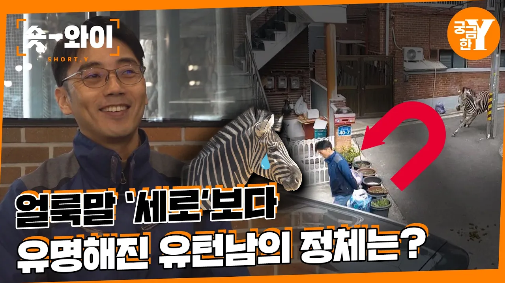

# [Y 630회 요약] 얼룩말 ‘세로’가 탈출한 진짜 이유는? | 숏와이

## 기본 정보
- **URL**: https://www.youtube.com/watch?v=akSMzeWaSTo
- **채널명**: 궁금한 Y
- **구독자수**: 50만
- **조회수**: 166,884
- **업로드일**: 2023-04-01
- **영상 길이**: 11:56
- **댓글 수**: 286
- **좋아요 수**: 2,068

## 썸네일

---

## 댓글 (추천순 TOP 10)

| 순위 | 좋아요 | 댓글 |
|------|--------|------|
| 1 | 145 | 울나라 동물원들 관리가 개판임ㅋㅋㅋㅋㅋ 대부분 한국 나이로 30살도 못넘기고 죽음 거의 동물학대수준이다. 영상에 사육사가 갑자기 부모 둘다 죽었다고 우연인 척하는데 걍 다 극심한 스트레스에 병들어 죽음 |
| 2 | 476 | 울타리를 높게하는것보다 말이 뛸수있는 넓은 공간을 확보해주세요. 세로도 뛰어놀아야 건강도 유지하고 우울증도 안걸리죠~ |
| 3 | 38 | 1주일에 한번은 어린이 대공원 문 닫고 을 뛰어다닐 수 있게 하면 어떨까요? 동물들....아니면 대공원 둘레를 빙 둘러서 울타리를 만들어서 거기서 대공원을 빙 둥글게 뛸 수 있게 |
| 4 | 8 | ​ @동물-r3h  오.. 좋은 아이디어 같아 보이네요. |
| 5 | 0 | 에버랜드봐라. 로스트밸리 그래도 넓은곳에서 애들 생활한다. |
| 6 | 10 | 걍 동물원 없애자. 종 보호를 위해서라도 있어야된다는데 그건 종 본래의 특성을 훼손하지 않는 야생에서 행해졌을때 의미가 있는거고, 저렇게 감옥에 가둬놓고 사육하는건 진짜 의미없는 종 보호지. 그냥 동물 박제한거랑 뭐가 다름? |
| 7 | 6 |  @BB-xm6eo  저도 동물원이 궁극적으로는 없어져야 한다고 생각합니다. 앞으로 vr과 같은 기술로 더욱 생생하게 동물들을 간접적으로 볼수 있는 세상에 저런 비윤리적인 방법의 동물원이 있어서는 안되니까요. 하지만 이미 기존에 있는 동물들 그리고 직간접적으로 고용되어있는 사람들 등 풀어야 할 현실적인 문제가 있는거지요. |
| 8 | 419 | 이거 웃긴거 아니예요. 수의사님 인터뷰 보세요.  세로는 사춘기도 아니고 삐진것도 아니고 낡은 동물원에서 전혀 시설 관리 되지 않은 곳에 갇혀 있다가 탈출했는데 그저 세로가 착해서 운좋게 아무 사고가 나지 않았기 때문에 그들이 책임을 회피하고자 감성을 더해 세로에게 사춘기라는 둥, 삐졌다는 둥의 표현을 쓰며 책임을 씌웠다고 했습니다.  말은 원래 하루 80km를 걷고 달리며 이동한답니다. 근데 그 좁은 공간에 혼자 가둬 놓으니 세로는 정신이 미칠 수 밖에 없는 환경이랍니다.  또 가족을 잃었으니까 부인을 데리고 온다는 것 또한 길들여지지 않는 말 두마리가 되는 것 뿐이라고 우려를 표했습니다.  저 동물원과 직원들은 처벌 받아야 합니다. 세로를 통해 의인화 하고 뻔뻔하게 잘못을 묻어가려 하는 것은 문제예요. |
| 9 | 30 | 진심 그런게 눈에보였어요 세로가 너무 불쌍합니다.😢 |
| 10 | 15 | 어느 정도 공감은 합니다만, 갑자기 동물원을 없앨수도 없고, 직원들은 뭘로 처벌할까요? |
