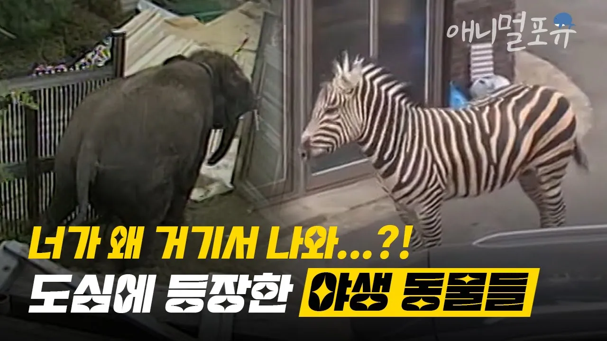

# 얼룩말만 탈출 한 줄 알았지? 가정집에 쳐들어간 코끼리부터 퓨마까지.. 역대 동물원 탈출 사건⛓️ | KBS 뉴스 방송

## 기본 정보
- **URL**: https://www.youtube.com/watch?v=-qPrSZeymgA
- **채널명**: KBS animal TV : animal4u
- **구독자수**: 158만
- **조회수**: 73,722
- **업로드일**: 2023-03-24
- **영상 길이**: 8:49
- **댓글 수**: 181
- **좋아요 수**: 494

## 썸네일

---

## 댓글 (추천순 TOP 10)

| 순위 | 좋아요 | 댓글 |
|------|--------|------|
| 1 | 64 | ⛓타임라인⛓
 00:00 얼룩말
 01:46 코끼리
 03:17 퓨마
 05:03 늑대
 08:07 곰 |
| 2 | 0 | 늑대면 늑구? |
| 3 | 56 | 퓨마랑 늑대 불쌍하네 ㅠ |
| 4 | 160 | 퓨마는 정말 안타까웠어요.. 탈출해서 세상으로 나온게 처음이라 구석에 움츠리고 있었대요... 얼마나 무서웠을지.. 결국 인간에의해 갇히고 탈출하고 죽은거에요.... 동물원이 과연 필요한걸까요 저는 아직도 모르겠어요  아이들 교육을위해서 동물원 많이데리고가는데 그게과연 아이의교육에 도움이 되는건지 모르겠어요 저는 아이를 낳아도 동물원은 안갈것같아요 아이의 무의식속에 동물은 이래도되는거라는걸 심어주고싶지않아요 모든생명은 동등하고 소중한건데.. 이 영상을 보니 너무 속상하네요.. |
| 5 | 16 | 동물원은 동물을 보호하는 역활도 해요  보호종 멸종을 막는 역활 |
| 6 | 9 |  @lulukim1724  역활아니고 역할이요 |
| 7 | 3 |  @himini409  그게 제일 창피한 지적중에 지적이죠 그 오타 그냥 넘어가면 안됨??? |
| 8 | 1 | ​ @김두성 이런 지적이야 말로 정말 할일없는 지적이네요 ㅌㅌ |
| 9 | 3 | ​ @한마-d2x 본인이야말로 잘 알지도 못하고 중간에서 웃긴 소리인건 인정 못하지요??? |
| 10 | 3 | ​ @한마-d2x 누가 누구에게 지적 타령인가요 이야 너무 웃겨서 댓글 남기고 갑니다 😊❤😊 |
