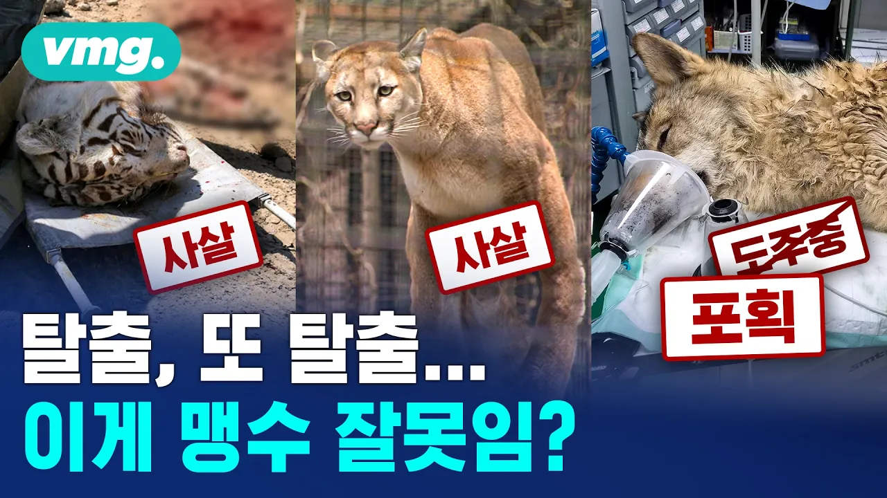

# 늑구는 돌아왔지만, 동물은 나가고 싶다.. 잇따른 탈출, 누구 잘못임? / 머그인사이트 / 비디오머그

## 기본 정보
- **URL**: https://www.youtube.com/watch?v=T8J9oPR4jSg
- **채널명**: VIDEOMUG
- **구독자수**: 187만
- **조회수**: 101,432
- **업로드일**: 2026-04-15
- **영상 길이**: 3:39
- **댓글 수**: 557
- **좋아요 수**: 1,243

## 썸네일

---

## 댓글 (추천순 TOP 10)

| 순위 | 좋아요 | 댓글 |
|------|--------|------|
| 1 | 363 | 그니까 왜 자꾸 문을 "잠깐" 열어 놓냐고 ㅋ |
| 2 | 14 | 이 번 오월드 늑구는 문열어논거 아니고  늑구가  땅파서우리밖으로 탈출한거임...  오월드 늑대사파리는 ㅈ진짜큽니다 |
| 3 | 155 | 늑구 경쾌한 발걸음.. 진짜 봄꽃구경 나와서 신난것 같잖아. 부디 돌아갈 땐 살아서 가길 |
| 4 | 118 | 1:47 사실전달을 똑바로 하세요 곤충 베테랑 사육사였잖아요  30년간 곤충관리하던 사육사를 맹수 담당으로 보내놓고 저런 일 터진건데 이걸 그냥 베테랑사육사라고 하면 맹수 담당 베테랑인줄 알거아님 |
| 5 | 3 | 뭔가 표현이 이상한 영상이긴 해요 애들이 문 열렸있으니 나간건데 그때를 노렸다 라든가 그것들이라는 표현이라니 ... 영상보다 인상이 찡그려 지네요 |
| 6 | 357 | 자는 얼마나 무서울까? |
| 7 | 270 | 오월드는 도대체 동물 관리를 어떻게 하는 거고 애들 탈출한 게 한두번도 아니고 인력 낭비에 돈 낭비에 늑구는 또 무슨 죄며 저러다 또 무슨 일 생기면 재규어 때처럼 사살할 거잖아 잘못은 지네가 했으면서 |
| 8 | 1 | 근데 인력에 들어가는 돈 오월드에서 부담하는거에요? |
| 9 | 0 | 퓨마 |
| 10 | 0 | 짐승들좀 없어졌으면 좋겠다 윗댓보면 짐승이네 ㅋㅋ |
